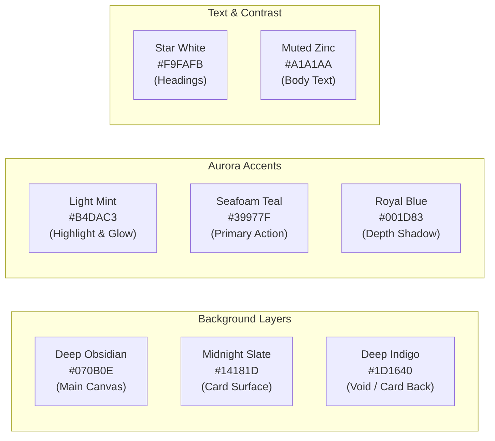

# Arcanfractal — Design System & UX/UI Specification

> **Full Documentation:** [`docs/DESIGN.md`](file:///c:/Users/Acer/Documents/Coding/Project/tarot-tajai/docs/DESIGN.md)  
> **Source of Truth:** [`docs/SDD.md`](file:///c:/Users/Acer/Documents/Coding/Project/tarot-tajai/docs/SDD.md) (§6) & [`app/globals.css`](file:///c:/Users/Acer/Documents/Coding/Project/tarot-tajai/app/globals.css)  
> **Status:** Active / Authoritative Design Guide  

---

## 1. Design Philosophy & Creative Direction

**Arcanfractal** ถูกสร้างขึ้นภายใต้แนวคิด:

> **"A Ritual with an AI Voice — พิธีกรรมที่สงบ โดยมี AI เป็นเพียงผู้ช่วยอ่านความหมาย ไม่ใช่แชตบอตทั่วไป"**

### Core UX Tenets:
1. **Frictionless Calm (ความสงบนิ่งไร้สิ่งรบกวน):**
   - ไม่มีป๊อปอัปโฆษณา, ไม่มีลูกเล่นหวือหวาเกินจำเป็น, ไม่มีสีฉูดฉาด
   - ให้ความรู้สึกเหมือนกำลังก้าวเข้าสู่พื้นที่ศักดิ์สิทธิ์ส่วนบุคคล (Sacred Sanctuary)
2. **True Agency (ผู้ใช้เป็นเจ้าของการเลือก):**
   - การสุ่มไพ่ต้องอาศัยการสัมผัสจริงจากผู้ใช้ (True Index Selection & Touch Reveal) ห้ามให้ระบบสุ่มแล้วเปิดให้ดูเองโดยผู้ใช้ไม่ได้มีส่วนร่วม
3. **Cool Midnight Mysticism (ลึกลับ เยือกเย็น ผ่อนคลาย):**
   - โทนสีหลักต้องอิงกับท้องฟ้ายามราตรี แสงออโรร่าเหนือผืนน้ำ (Lakeside Aurora Borealis) **ห้ามใช้สีโทนร้อน เช่น ส้ม แดงสด หรือเหลืองอำพัน (Amber) เป็นสีหลักของธีมเด็ดขาด**
4. **Private & Respectful:**
   - การสื่อสารและคำแนะนำต้องให้พลังใจ (Empowerment & Reflection) ไม่ชี้นำแบบงมงาย และเคารพความเป็นส่วนตัวของผู้ใช้อย่างสูงสุด

---

## 2. Locked Color Palette: Lakeside Aurora Borealis

ระบบใช้ชุดสีที่ถูกล็อกตายตัว (Locked Palette) ตาม SDD §6.1 และ `@theme` ใน `app/globals.css`:



### Color Token Reference Table

| Color Token | Hex Code | Tailwind / CSS Var | บทบาทและหน้าที่ในระบบ (Usage) |
|---|---|---|---|
| **Deep Obsidian** | `#070B0E` | `--color-deep-obsidian` / `bg-[#070b0e]` | พื้นหลังหลักทั้งระบบ (Canvas Background) |
| **Midnight Slate** | `#14181D` | `--color-midnight-slate` / `bg-[#14181d]` | พื้นผิวของกล่องการ์ด, Capsule, และ Modal (`bg-[#14181d]/85`) |
| **Deep Indigo** | `#1D1640` | `--color-aurora-indigo` / `bg-[#1d1640]` | เลเยอร์หลังไพ่ (Card Back) และเงามืดลึก |
| **Light Mint** | `#B4DAC3` | `--color-aurora-mint` / `text-emerald-200` | แสงออโรร่าเรืองรอง, ข้อความเน้นหัวข้อ, จุดประกายดาว |
| **Seafoam Teal** | `#39977F` | `--color-aurora-teal` / `text-teal-400` | สี Accent หลัก, เส้นขอบ Active, ปุ่ม Call-to-Action |
| **Star White** | `#F9FAFB` | `--color-star-white` / `text-white` | หัวข้อหลัก (Headings H1, H2), ข้อความคอนทราสต์สูง |
| **Muted Zinc** | `#A1A1AA` | `text-zinc-400` | คำอธิบายรอง (Body Subtitles), เมตาดาต้า, วันที่ |
| **Nebula Purple** | `#3D276F` | `--color-aurora-purple` | หมอกออโรร่าเสริมในแอนิเมชัน Background |
| **Royal Blue** | `#001D83` | `--color-aurora-royal` | มิติเงาลึกด้านหลังไพ่และแบนเนอร์ |

### ⚠️ Strict Color Rules & Anti-Patterns
- **ห้ามใช้สีโทนส้ม/ทองเหลืองอำพัน (Amber / Orange / Gold) เป็นสีพื้นผิวหรือสีหลัก:** การใช้สี Amber จะทำลายบรรยากาศ Lakeside Aurora ทำให้กลายเป็นแอปดวงสไตล์ดั้งเดิมที่ฉูดฉาด
- **สีสถานะเฉพาะทาง (Functional Status Colors):**
  - **Success / Complete:** Mint / Emerald (`text-emerald-400`, `border-emerald-500/40`)
  - **Active / Focused:** Seafoam Teal (`text-teal-300`, `border-teal-500/50`)
  - **Reversed Card / Warning:** Soft Rose / Crimson (`text-rose-400`, `border-rose-500/40`, `bg-rose-950/40`)
  - **Crisis / Alert:** Muted Rose / Crimson (`#F43F5E`) แสดงเฉพาะในกรณี Crisis Support เท่านั้น

---

## 3. Typography Hierarchy

ระบบใช้การจับคู่ฟอนต์แบบ **Serif (หัวข้อศักดิ์สิทธิ์) + Sans-Serif (เนื้อหาอ่านง่าย)**:

### Font Families
- **Headings (หัวข้อหลัก / ชื่อไพ่ / คำโปรยศักดิ์สิทธิ์):**
  - ภาษาอังกฤษ: `Cinzel` หรือ `Playfair Display` (`font-serif`)
  - ภาษาไทย: `Sarabun` หรือ `Noto Serif Thai`
  - คลาส: `font-serif font-bold text-white tracking-tight`
- **Body & UI (เนื้อหา / คำแนะนำ / ปุ่มกด / เมนู):**
  - ภาษาอังกฤษ: `Plus Jakarta Sans` หรือ `Inter` (`font-sans`)
  - ภาษาไทย: `Sarabun`
  - คลาส: `font-sans text-zinc-300 font-normal leading-relaxed`
- **Metadata & Counters (ตัวเลขนับคำ / สถิติ / วันที่):**
  - ฟอนต์: `JetBrains Mono` หรือ Monospace (`font-mono text-zinc-400 text-xs`)

### Scale & Spacing
- **Display Hero (H1):** `text-3xl sm:text-5xl md:text-6xl font-serif font-normal text-white`
- **Section Heading (H2):** `text-2xl sm:text-3xl font-serif font-bold text-white`
- **Card Title (H3):** `text-lg sm:text-xl font-serif font-bold text-emerald-100`
- **Body Regular:** `text-sm sm:text-base text-zinc-300 leading-relaxed`
- **Subtext / Captions:** `text-xs text-zinc-400`
- **Badge / Eyebrow:** `text-[11px] font-semibold tracking-wider uppercase text-emerald-300`

---

## 4. Layout & Ergonomics Standards

### 1. Mobile-First (Base: 360px)
- **Viewport Support:** รองรับสมบูรณ์ตั้งแต่จอแคบสุด 360px (Samsung Galaxy S, iPhone SE) จนถึงจอกว้าง
- **Thumb Zone Design:**
  - ปุ่ม Action หลัก (เช่น Continue, Begin Ritual, Reveal) ต้องอยู่ในระยะนิ้วโป้งของผู้ใช้มือเดียว
  - ความสูงของปุ่มขั้นต่ำ: `48px` (`min-height: 48px`, tap target `>= 44x44px`)
  - ไม่มีปุ่มสำคัญอยู่ชิดขอบจอเกินไป (Safe area padding `env(safe-area-inset-bottom)`)

### 2. Desktop Centered Layout (Max 1100px)
- **Constraint:** บนจอเดสก์ท็อป กำหนดพื้นที่ความกว้างสูงสุดไว้ที่ `1100px` (`max-w-[1100px] mx-auto px-4`)
- **Reading Ritual Stage:** พื้นที่ทำพิธีกรรมจัดวางอยู่กึ่งกลางสายตาเสมอ (`max-w-2xl` หรือ `max-w-3xl`) เพื่อรักษาความจดจ่อ

---

## 5. Component Design Specifications

### 1. The Cinematic Capsule (Surface Card)
ใช้สำหรับกล่องคำถาม (Question Box), การ์ดสรุปผล (Result Card), และแบนเนอร์ประจำวัน (Daily Banner):
```tsx
// Pattern ตัวอย่างของพื้นผิว Glassmorphism แบบทางการ
<div className="relative overflow-hidden rounded-2xl border border-white/[0.12] bg-[#14181d]/85 p-5 sm:p-6 shadow-[0_15px_40px_rgba(0,0,0,0.6)] backdrop-blur-2xl transition-all hover:border-emerald-500/40 hover:shadow-[0_15px_45px_rgba(16,185,129,0.12)]">
  {/* Aurora Ambient Glow ด้านหลัง */}
  <div className="pointer-events-none absolute -top-12 -left-12 h-36 w-36 rounded-full bg-emerald-500/10 blur-3xl" />
  {/* Content */}
</div>
```

### 2. Status & Eyebrow Badges
ใช้สำหรับระบุโหมด ขั้นตอน หรือหมวดหมู่:
```tsx
// รูปแบบ Pill Badge
<span className="inline-flex items-center gap-1.5 px-2.5 py-0.5 rounded-full bg-emerald-500/10 border border-emerald-500/30 text-[11px] font-semibold tracking-wider uppercase text-emerald-300">
  <Sparkles className="w-3 h-3 text-emerald-400" />
  Daily Ritual
</span>
```

### 3. Action Buttons
- **Primary Action (Call-to-Action):**
  - `bg-emerald-500/20 hover:bg-emerald-500/30 text-emerald-200 border border-emerald-400/50 shadow-[0_0_20px_rgba(16,185,129,0.2)]`
- **Secondary / Ghost Action:**
  - `bg-white/[0.05] hover:bg-white/[0.09] text-zinc-300 border border-white/[0.1]`
- **Destructive / Delete Action:**
  - `bg-rose-950/40 hover:bg-rose-900/50 text-rose-300 border border-rose-500/30`

---

## 6. Tarot Card 3D Flip & Reveal Specifications

การแสดงผลไพ่คือหัวใจสำคัญของพิธีกรรม ต้องปฏิบัติตามมาตรฐานต่อไปนี้อย่างเคร่งครัด:

1. **Card Aspect Ratio:** อัตราส่วนความกว้างต่อความสูงประมาณ `1:1.6` (เช่น `200px × 320px` หรือ `230px × 380px`)
2. **3D Flip CSS Transform:**
   - Container ต้องมี `[perspective:1000px]`
   - Flipped Inner ต้องมี `[transform-style:preserve-3d]`
   - Face-Down (หลังไพ่) และ Face-Up (หน้าไพ่) ต้องมี `[backface-visibility:hidden]`
   - เมื่อเปิดไพ่: หมุนแกน `rotateY(180deg)` ด้วยความเร็ว `0.8s` (Bezier: `[0.22, 1, 0.36, 1]`)
3. **Reversed Cards (ไพ่กลับหัว):**
   - ด้านหน้าของไพ่กลับหัวจะต้องใส่คลาส `rotate-180` เพิ่มเติม และมี Badge กำกับชัดเจน
4. **Accessibility (Reduced Motion):**
   - หากผู้ใช้เปิด `prefers-reduced-motion` ในระบบปฏิบัติการ ระบบต้องปิด 3D Rotation และสลับเป็น **Opacity Cross-Fade** ความเร็ว `0.3s` ทันที

---

## 7. UI Verification Checklist (สำหรับทุกการแก้ไขและ PR)

ก่อนส่งมอบงาน UI ทุกครั้ง ต้องผ่านการตรวจสอบตามเกณฑ์ต่อไปนี้:

- [ ] **Color Compliance:** ไม่มีสีส้ม/เหลืองอำพัน (`amber`, `yellow`, `orange`) ปรากฏบนพื้นผิวหลัก ใช้เฉพาะ Aurora Mint, Teal, Deep Obsidian, Midnight Slate
- [ ] **Contrast & Readability:** ตัวหนังสือทั้งหมดมี Contrast ผ่านเกณฑ์ WCAG AA บนพื้นหลังมืด
- [ ] **Mobile Responsiveness:** ทดสอบบน Viewport กว้าง 360px ไม่มีส่วนใดล้นจอในแนวนอน (No Horizontal Overflow)
- [ ] **Tap Target Sizes:** ปุ่ม Action ทุกปุ่มสูงอย่างน้อย 44px–48px และแตะได้ง่ายด้วยนิ้วโป้ง
- [ ] **Reduced Motion Support:** ใช้องค์ประกอบ Framer Motion ที่รองรับ `useReducedMotion()` ทุกจุด
- [ ] **Font Hierarchy:** หัวข้อใช้ฟอนต์ Serif, เนื้อหาคำบรรยายใช้ฟอนต์ Sans-Serif
- [ ] **Glassmorphism Consistency:** กรอบ Card ทุกใบใช้ `border-white/[0.12]`, `bg-[#14181d]`, และ `backdrop-blur` สอดคล้องกันทั้งแอป
