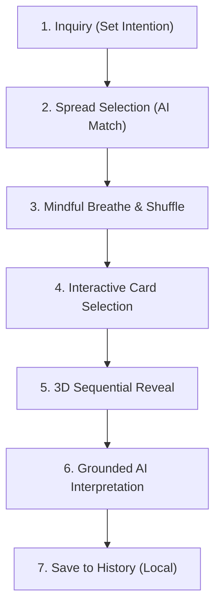

# Arcanfractal — AI-Powered Mindful Tarot Sanctuary

> *"A contemplative Tarot sanctuary offering grounded, reflective readings powered by AI and timeless Rider-Waite-Smith wisdom."*

Arcanfractal is a web application designed as a sacred, distraction-free space for introspective clarity. By marrying timeless 78-card Tarot archetypes with modern Web Crypto algorithms and high-fidelity LLM synthesis, Arcanfractal facilitates personal agency and mindful contemplation rather than superstitious fortune-telling.

---

## 🌟 Key Features & Sacred Invariants

- **🎲 Cryptographically Secure Shuffling**: Implements the Fisher-Yates shuffle powered by the Web Crypto API (`crypto.getRandomValues`), guaranteeing unbiased distribution with zero modulo bias across the full 78-card deck.
- **✋ True Index Selection**: The user actively selects card positions from the fanned deck; cards are never pre-assigned or passively forced by the system.
- **🛡️ Zero Hallucination Guard**: Automated self-repair validation pipeline ensuring that the AI interpretation references *only* cards actually drawn in the reading.
- **🧭 Intelligent Spread Recommendation**: Heuristic multi-keyword lexicon and scoring engine that analyzes user questions to match the most empowering spread:
  - **1-Card Daily / Single Focus**: Immediate clarity or quick check-in.
  - **3-Card Linear**: Past, Present, and Future trajectory.
  - **3-Card Decision**: Option A, Option B, and Synthesis for crossroads.
  - **4-Card Situation Analysis**: Situation, Challenge, Hidden Influence, Advice.
  - **5-Card Cross**: Deep psychological analysis and holistic outlook.
- **🌅 Daily Card Ritual (`/daily`)**:
  - One card drawn per calendar day with automatic midnight resets (local time).
  - Dual-language micro-interpretations (Affirmation, Daily Theme, Actionable Advice).
  - Streak tracking and historical calendar viewer saved locally.
- **✨ 3D Sequential Card Reveal**: Smooth perspective-rendered card flips with tactile feedback and progressive disclosure.
- **🆘 Crisis Safety Support**: Proactive keyword detection that detects despair or crisis signals, providing emergency mental health helpline hotlines immediately without fatalistic interpretation.
- **🔒 Privacy-First**: Complete reading sessions and history are persisted locally in client storage (`localStorage` / `sessionStorage`) with zero third-party telemetry.

---

## 🏗️ Architecture & Ritual Flow



---

## 🛠️ Tech Stack

| Layer | Technology | Details |
|---|---|---|
| **Framework** | Next.js 16 (App Router) | Turbopack, Server-Side API Routes, Edge-ready |
| **Language** | TypeScript 5 | Strict mode, End-to-end type safety |
| **Styling** | Tailwind CSS v4 | Custom *Lakeside Aurora Borealis* dark design tokens |
| **Typography** | Google Fonts | Cinzel (Editorial Serif), Plus Jakarta Sans, Sarabun |
| **Animations** | Framer Motion | 3D card flips, smooth drawer transitions |
| **Icons & UI** | Lucide React + Radix UI | Minimalist, accessible design primitives |
| **AI Integration** | KKU IntelSphere / Gemini | OpenAI-compatible adapter with zero-hallucination fallback |
| **Testing** | Vitest | 22 test suites, 189+ unit and integration tests |

---

## 🚀 Getting Started

### Prerequisites

- Node.js `20.x` or later
- Package manager: `pnpm` (recommended), `npm`, or `yarn`

### 1. Clone & Install Dependencies

```bash
git clone https://github.com/Dulyadech/Arcanfractal.git
cd tarot-tajai
pnpm install
```

### 2. Environment Configuration

Copy the example environment file:

```bash
cp .env.example .env.local
```

Configure your credentials inside `.env.local`:

```env
# Application URL
NEXT_PUBLIC_APP_URL=http://localhost:3000

# KKU IntelSphere API (Primary Provider)
KKU_INTELSPHERE_API_KEY=your_api_key_here
KKU_INTELSPHERE_BASE_URL=https://gen.ai.kku.ac.th/api/v1
KKU_INTELSPHERE_MODEL=gemini-3.8-flash

# Google Gemini API (Backup Fallback Provider)
GEMINI_API_KEY=your_gemini_key_here
GEMINI_MODEL=gemini-2.5-flash

# Rate Limiting
RATE_LIMIT_MAX_REQUESTS_PER_MINUTE=20
```

### 3. Run Development Server

```bash
pnpm dev
```

Open [http://localhost:3000](http://localhost:3000) in your browser.

### 4. Running Tests

Execute the comprehensive test suite with Vitest:

```bash
pnpm test
```

---

## 📂 Project Structure

```
├── app/
│   ├── api/
│   │   ├── draw/               # Cryptographic card draw endpoint
│   │   ├── health/             # System health & provider check
│   │   ├── interpret/          # AI interpretation engine with hallucination repair
│   │   └── recommend-spread/   # Heuristic spread recommendation endpoint
│   ├── daily/                  # Daily Card Ritual view
│   ├── history/                # Saved reading history view
│   ├── read/                   # Main reading flow (Spread -> Shuffle -> Pick -> Result)
│   ├── layout.tsx              # Root layout with Aurora background & global providers
│   └── page.tsx                # Homepage featuring minimal AI conversational prompt
├── components/
│   ├── daily/                  # Daily ritual cards, streaks, and history calendar
│   ├── landing/                # QuestionForm capsule, guidance drawer, inspiration chips
│   ├── layout/                 # Header, Footer, CaveMoonlightBackground
│   ├── reading/                # SpreadSelection, DeckShuffle, CardSelection, ReadingResult
│   └── safety/                 # CrisisPanel intervention modal
├── data/                       # 78 Tarot cards data, spreads catalog, inspiration prompts
├── lib/
│   ├── ai/                     # LLM client adapters (KKU IntelSphere & Gemini fallback)
│   ├── i18n/                   # Bilingual translations (EN / TH) & context
│   ├── safety/                 # Crisis intent detection
│   ├── storage/                # LocalStorage & SessionStorage managers
│   └── tarot/                  # RNG shuffling, card images, scoring, interpretation logic
└── tests/                      # Unit & integration test suites
```

---

## 🎨 Design System: Lakeside Aurora Borealis

- **Deep Obsidian (`#070B0E`)**: Primary dark canvas background.
- **Midnight Slate (`#14181D`)**: Translucent capsule cards and container surfaces.
- **Deep Indigo (`#1D1640`)**: Void layers and card back gradient anchors.
- **Light Mint (`#B4DAC3`)**: Aurora glow highlights and glowing serif accents.
- **Seafoam Teal (`#39977F`)**: Primary CTA borders, active badges, and focus rings.

---

## ⚖️ Disclaimer

Arcanfractal is designed for personal mindfulness, self-reflection, and archetypal inquiry. It is not intended as medical, financial, or legal advice, nor does it claim to predict future events with certainty. If you or someone you know is experiencing distress, please reach out to professional mental health resources or local crisis hotlines.

---

## 📄 License

This project is licensed under the MIT License — see the repository for full license details.
